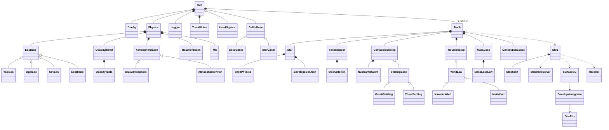

# A new design for YREC

*Stage 2 of the overhaul: KC's coding style applied to YREC at the release `rp_1`, and an object-oriented framework designed from the code's real responsibilities, as the file notes describe them. Drafted by Claude (Oct 25, 2026) for Kaili Cao; nothing is refactored yet. The style is KC's coding style, with effortless as the model package. Its guide is written for Python; [Section 6](fortran.md) says how each of its conventions carries over to modern Fortran, and where a Python interface fits. Where the guide says nothing, the choice made is stated, with its reason.*

**The design follows YREC's development branch (09c3b9b, Oct 20, 2026).** It was written for `rp_1`; the development branch has since removed obsolete options (the MHD, OPAL 1995 and OPAL 2001 equations of state; the OPAL 1992, LAOL 1989, Alexander 1995 and Kurucz 1990 opacity tables, apart from LAOL's pure-$Z$ table; the Monte Carlo loop and its output, `WRTMONTE`), with the helper routines only they used, and has turned every COMMON block into a module. The design drops the same options (the pages below say which members of a family went), and names the modules where it used to name blocks ([Section 6.4](common-map.md)).

This design is split into pages, one per component; this page holds its goals, the package layout, the data flow, the migration and the open questions:

- [Kernels and settings](kernels.md) (Sections 3.1, 3.2)
- [Microphysics](microphysics.md) ([Section 3.3](microphysics.md))
- [The star and its state](star.md) ([Section 3.4](star.md))
- [The structure solver](structure.md) (Sections 3.5–3.7)
- [Time stepping](timestep.md) ([Section 3.8](timestep.md))
- [Composition and settling](composition.md) ([Section 3.9](composition.md))
- [Rotation and mass loss](rotation.md) (Sections 3.10, 3.11)
- [The run and calibrations](run.md) (Sections 3.12, 3.13)
- [Input, output and analysis](io.md) ([Section 3.14](io.md))
- [Tunable numbers](tunables.md) ([Section 5](tunables.md))
- [Language and style](fortran.md) (Sections 6.1–6.3)
- [The COMMON-block map](common-map.md) ([Section 6.4](common-map.md))
- [Hooks for user-defined physics](hooks.md) ([Section 6.5](hooks.md))

*In Python: [the Python version's overview](overview.md), under Python below.*

## 1. What the design is for

YREC's physics is mature and validated, and its explanations show a code that works; its structure is what makes it hard to read, to test piece by piece and to extend. **Global state:** at `rp_1`, routines shared data through 243 COMMON blocks as much as through arguments; the constants alone (`/CONST1/`) were declared in 93 units, the output units (`/LUOUT/`) in 88, and [[parmin.f#PARMIN|`PARMIN`]] declared 86 blocks and [[main.f|`main.f`]] 60. The development branch has made them 87 modules, which names the data but keeps it global. Settings in COMMON are changed for good in the middle of a run: [[mix.f#MIX|`MIX`]] switches settling off for the rest of the run (`LDIFY`), [[htimer.f#HTIMER|`HTIMER`]] switches the structure time-step criterion off for the whole job (`LPTIME`), and [[envint.f#ENVINT|`ENVINT`]] switches the run to gray atmospheres after one failed Allard lookup (`KTTAU = 0`). A block that was not declared became a silent local: at `rp_1`, [[seculr.f#SECULR|`SECULR`]] tested `LCODM` and `CODM` without declaring `/MAG/` (the development branch, with `IMPLICIT NONE` everywhere, has fixed this). **No checked interfaces:** every routine is an external subprogram, so argument lists are never checked; at `rp_1`, [[massloss.f#MASSLOSS|`MASSLOSS`]] passed [[mdot.f#MDOT|`MDOT`]] one argument (`BL`) more than it takes (fixed in the development branch); [[main.f|`main.f`]] still passes an undefined `IU` to [[engeb.f#ENGEB|`ENGEB`]], and [[reduce.f#REDUCE|`REDUCE`]] takes 39 arguments. **Procedures that are objects in disguise:** state and the routines that use it are tied together only by COMMON and `SAVE`: [[quadeos06.f#QUADEOS06|`QUADEOS06`]] keeps 30 cache slots that the caller must reuse with the same abscissas, [[ratext.f#RATEXT|`RATEXT`]] depends on the previous call, and each table family (the OPAL equation of state, the opacity tables, three atmosphere tables) is a set of reader, set-up and lookup routines sharing hidden blocks. **One long main program:** [[main.f|`main.f`]] runs the calibrations, the run cards and the evolution step in one routine with `GOTO`s across loop levels (at `rp_1`, the Monte Carlo loop too), and [[parmin.f#PARMIN|`PARMIN`]] is 1,508 lines of defaults, namelist reading, derived settings, file opening and run cards. **Duplicated code:** at `rp_1`, the three OPAL equation-of-state versions repeated each routine (`ESAC`/`ESAC01`/`ESAC06`, `READCO…`, `RHOOFP…`, `T6RINTERP…`, `EQBOUND…`, `RADSUB…`, `QUAD…`), and the second-metallicity tables repeated theirs (`GTLAOL2`, `KURUCZ2`, `YLLO2D2`, `YLLO3D2`); the development branch removed both with their options; [[rates.f#RATES|`RATES`]] repeats most of [[engeb.f#ENGEB|`ENGEB`]], "so a change to one must be copied to the other"; there are seven cubic-spline routines and three tridiagonal solvers; two settling solvers ([[grsett.f#GRSETT|`GRSETT`]], "retained for backwards compatability", and [[microdiff.f#MICRODIFF|`MICRODIFF`]]); [[putstore.f#PUTSTORE|`PUTSTORE`]] is "mostly a clone of wrtlst.f and putmodel2.f". **Fixed sizes:** at `rp_1`, 123 of the 254 files declared `JSON = 5000` shells (the comment in `main.f` still says to change it "by a global change"); the development branch declares it once, in [[dimensions_mod.f#DIMENSIONS_MOD|`DIMENSIONS_MOD`]], but it is still fixed when the code is compiled. Table sizes are typed into `DATA` statements or initial values (the grids of [[ll95tbl.f|`LL95TBL`]], now in [[llot95a_mod.f#LLOT95A_MOD|`LLOT95A_MOD`]]; the edges `NTA`, `NRA` of the OPAL 2006 table in [[eos06misc_mod.f#EOS06MISC_MOD|`EOS06MISC_MOD`]]; the dimensions repeated in the `OP95…` files). **Hard exits and stray output:** YREC has no interactive prompts (it reads two namelists and runs unattended), but errors end the program with `STOP` (for example `STOP 9999` in [[starin.f#STARIN|`STARIN`]] and [[alfilein.f#ALFILEIN|`ALFILEIN`]], and a model that fails to converge, which `STARIN` stops), which would also end any Python process that called it, and several routines write to the terminal at every call ([[massloss.f#MASSLOSS|`MASSLOSS`]], [[mdot.f#MDOT|`MDOT`]], [[rscale.f#RSCALE|`RSCALE`]], [[taucal.f#TAUCAL|`TAUCAL`]], [[bsrotmix.f#BSROTMIX|`BSROTMIX`]]). **Dead paths:** `LBURS` is always false, so [[bursmix.f#BURSMIX|`BURSMIX`]] never runs; the receding-convection-zone block of [[midmod.f#MIDMOD|`MIDMOD`]], the old method of [[chkcal.f#CHKCAL|`CHKCAL`]] and the output of [[checkj.f#CHECKJ|`CHECKJ`]] are skipped; at `rp_1`, `WCZ` and four files were never called (the development branch has removed some of them: [Section 8](overview.md), question 5). The design below gives each piece of state one owner, each family of alternatives one base type, and each choice that users make one place to make it, so that each of these can be fixed once, and so that new physics can be added without editing the solver.

## 2. The package layout

The design keeps YREC's vocabulary (kind cards, the envelope triangle, `HCOMP`, levels of the Henyey iteration), so that its users can read the new code. The Fortran package is layered by dependency, from `kinds` at the bottom to `evolve` at the top (the tree lists the modules in that order, with `capi` above them all); a lower module never uses a higher one (the compiler enforces this, since modules cannot use each other in a circle). The Python package sits on top of the compiled library, and `drivers/` holds thin, run-specific scripts, as in effortless.

```text
yrec/                       # repo root: README.md, LICENSE, fpm.toml,
│                           # pyproject.toml, .gitignore
├── src/                    # the Fortran package (Fortran 2008)
│   ├── kinds.f90           # dp, sp; species indices (I_H1, I_HE4, ...)
│   ├── constants.f90       # physical constants, cgs, with sources
│   ├── numerics.f90        # kernels: splines, tridiagonal, LU, quadrature
│   ├── odeint.f90          # OdeRhs, Bulirsch-Stoer (BSSTEP, MMID, RATEXT)
│   ├── logger.f90          # Logger: the .short file, levels, timing
│   ├── config.f90          # Config and its parts; namelists; KindCard
│   ├── eos.f90             # EosBase, YaleEos, ScvEos, OpalEos,
│   │                       # EosBlend
│   ├── opacity.f90         # OpacityTable family, ConductiveOpacity,
│   │                       # OpacityBlend
│   ├── atmosphere.f90      # AtmosphereBase, GrayAtmosphere,
│   │                       # TableAtmosphere family
│   ├── nuclear.f90         # ReactionRates, NuclearNetwork, Deuterium,
│   │                       # LightElements, NeutrinoLosses
│   ├── convection.f90      # Mlt (TPGRAD)
│   ├── star.f90            # Physics, Star, ShellPhysics,
│   │                       # EnvelopeSolution, StepStart
│   ├── zones.f90           # ConvectionZones (CONVEC, OVERSH, FINDSH)
│   ├── hooks.f90           # UserPhysics: hooks for user physics
│   ├── envelope.f90        # EnvelopeIntegrator, SurfaceBC
│   ├── structure.f90       # StructureSolver (Henyey)
│   ├── rezone.f90          # Rezoner
│   ├── timestep.f90        # TimeStepper, StepCriterion family
│   ├── settling.f90        # SettlingBase, GrsettSettling,
│   │                       # ThoulSettling, EqualGrid
│   ├── mixing.f90          # CompositionStep (MIX), Semiconvection, ChiGrid
│   ├── rotation.f90        # Distortion, RotationLaw, RotationTransport,
│   │                       # WindLaw family, RotationStep
│   ├── massloss.f90        # MassLossLaw family, MassLoss
│   ├── io_model.f90        # ModelFile family: MODEL2, YREC7, .store
│   ├── analysis.f90        # AcousticAnal, MilneAnal, OverturnAnal
│   ├── io_output.f90       # TrackWriter, ShortWriter, PulsationWriter
│   ├── calibr.f90          # SolarCalibr, StarCalibr
│   ├── evolve.f90          # Run, Track, Step
│   └── capi.f90            # bind(C) layer: handles for Python
├── python/yrec/            # the Python package
│   ├── __init__.py         # version; loads the library
│   ├── _capi.py            # ctypes declarations of capi.f90
│   ├── config.py           # Config as a dataclass; namelist I/O
│   ├── star.py             # Star: NumPy views of the model arrays
│   ├── run.py              # Run, Track: step-by-step control
│   └── hooks.py            # user physics written in Python
├── drivers/                # one short script per run; paths live here
│   ├── yrec.f90            # the executable: reads nml1, nml2, runs
│   ├── run_solar_calibr.py
│   └── run_grid.py
├── input/                  # tables and starting models (as today)
└── tests/                  # pytest: references, analytic checks
```

`yrec.f90` keeps today's command line (`yrec run.nml1 run.nml2`) and file outputs, so existing namelists, scripts and the test suite run unchanged. The name `capi.f90` and the Python modules are a proposal; their scope is [Section 6.3](fortran.md).

## 3. The classes

Each class is a Fortran derived type with type-bound procedures ([Section 6.2](fortran.md) gives the conventions). Signatures are shown in short form: the procedure's header and a docstring of `!!` lines in NumPy style, with shapes and units; the declarations they imply follow [Section 6.2](fortran.md) (`intent`, kind `dp` unless stated, `ierr` an integer error code, 0 for success). `m` is the number of shells, `nsp = 15` the number of species in `HCOMP` (in the order the code prints: $X$, $Y$, $Z$, ³He, ¹²C, ¹³C, ¹⁴N, ¹⁵N, ¹⁶O, ¹⁷O, ¹⁸O, ²H, ⁶Li, ⁷Li, ⁹Be). Arrays are allocated to `m`, not to `JSON`.

Classes mirror the data, from the whole job down to the piece processed at a time:

```text
Run            # the job: Config, physics, run cards; replaces main.f
├── Track      # one run card: a sequence of models
│   ├── Star       # one stellar model; holds ShellPhysics, EnvelopeSolution
│   └── Step       # one evolutionary step; holds StepStart
└── Physics    # microphysics, set up once: Eos, opacity, atmosphere,
               # nuclear, convection; shared by every Track
```

### 3.15 How the classes relate

Composition (a type holds another) runs from the job down; inheritance only inside each family of alternatives.



`Physics` is defined in `star.f90`, above the families it holds, so that every stage from the envelope up can use it. The opacity, atmosphere and model-file families are drawn only by their base, to keep the diagram readable; their subclasses are listed above.

## 4. Data flow

A run goes through the new classes in the order of [[main.f|`main.f`]] today; each step names the code it replaces.

1. **Start.** `drivers/yrec.f90` reads the two namelist paths from the command line (`GETARG` today) and calls `Run%init`: `Config%read_namelists` and `Config%derive` ([[parmin.f#PARMIN|`PARMIN`]], [[remap.f#REMAP|`REMAP`]]), `Logger` and `TrackWriter` open their files, and `Physics%setup` reads the tables ([[setups.f#SETUPS|`SETUPS`]]).
2. **Calibration set-up.** If the configuration asks for one, `Run` allocates a `SolarCalibr` or `StarCalibr` ([[setcal.f#SETCAL|`SETCAL`]], [[setscal.f#SETSCAL|`SETSCAL`]]).
3. **Tracks.** For each kind card (`DO 200 NK`), `Run%run` creates a `Track`; `Track%start` reads or keeps the model through a `ModelFile` and rescales it ([[starin.f#STARIN|`STARIN`]], [[rscale.f#RSCALE|`RSCALE`]]), finds the zones ([[findsh.f#FINDSH|`FINDSH`]]), writes the headers ([[wrthead.f#WRTHEAD|`WRTHEAD`]]), copies the model to the `ILAST` file when the helium flash is followed (`LKUTHE`, [[wrtlst.f#WRTLST|`WRTLST`]]; MAIN question 4) and asks the `TimeStepper` for the first step ([[htimer.f#HTIMER|`HTIMER`]]).
4. **Steps.** `Track%run` repeats `Step%run` (`DO 100 MODELN`) until `Track%done`; each `Step%run`:
   1. lets `PulsationWriter` decide on this model's pulsation output ([[pdist.f#PDIST|`PDIST`]]), and copies the model into `StepStart` ([[oldmod_mod.f#OLDMOD_MOD|`OLDMOD_MOD`]] today);
   2. if the model ages, `MassLoss%apply` ([[massloss.f#MASSLOSS|`MASSLOSS`]]), then `CompositionStep%run` ([[mix.f#MIX|`MIX`]]), and advances the age;
   3. `Rezoner%rezone` ([[hpoint.f#HPOINT|`HPOINT`]]);
   4. guesses the new structure from the rates of change in `StepStart`, and, for the light elements, has `LightElements` compute the rates at the start of the step ([[lirate88.f#LIRATE88|`LIRATE88`]], mode 1);
   5. calls `StructureSolver%solve` at levels 1 to 3 ([[crrect.f#CRRECT|`CRRECT`]]), with `SurfaceBC` rebuilt at level 2, and stores the rates of change for the next guess; on divergence it returns an error, which ends the run as today (label 15; [Section 3.12](run.md));
   6. then, `ITDIF1` times with rotation (once without), restoring the start-of-step composition and $j$ before each repeat: level 4 of `StructureSolver%solve`, the convergence test, `ConvectionZones%homogenize` ([[mixcz.f#MIXCZ|`MIXCZ`]]), `RotationStep%run` and `Distortion%factors` ([[getw.f#GETW|`GETW`]], [[fpft.f#FPFT|`FPFT`]]);
   7. `ConvectionZones%find_shell` ([[findsh.f#FINDSH|`FINDSH`]]); the light elements, without rotational mixing: `ConvectionZones%find` ([[convec.f#CONVEC|`CONVEC`]]), the rates at the end of the step and the burning (`LightElements`, [[lirate88.f#LIRATE88|`LIRATE88`]] mode 2, [[liburn.f#LIBURN|`LIBURN`]]); after a change of mass, `Rezoner%absorb_envelope` and `Distortion%factors` again ([[getnewenv.f#GETNEWENV|`GETNEWENV`]], [[fpft.f#FPFT|`FPFT`]]);
   8. `TimeStepper%next_dt` ([[htimer.f#HTIMER|`HTIMER`]]), with the floor on the final step before `ENDAGE`;
   9. `TrackWriter` writes the model ([[wrtout.f#WRTOUT|`WRTOUT`]]), with the analyses it asks for; a `StarCalibr`'s `after_model` may end the track ([[chkscal.f#CHKSCAL|`CHKSCAL`]]).
5. **End of a track.** `StoreFile%write` if asked ([[putstore.f#PUTSTORE|`PUTSTORE`]]); a `SolarCalibr`'s `check` decides whether another cycle runs ([[chkcal.f#CHKCAL|`CHKCAL`]]), and `KTTAU` and `LPTIME` return to their configured values for the next cycle (in the design, a new `AtmosphereSwitch` and `TimeStepper`).
6. **End of the job.** Calibration summaries (at `rp_1` also the Monte Carlo output, `WRTMONTE`, removed in the development branch); `Run%clear`. The driver, not the library, ends the program, with a nonzero exit code if `ierr` is not 0.

In code, the step reads as its outline:

```fortran
subroutine step_run(self, ierr)
    !! One evolutionary step (main.f, DO 100). ierr : 0, or STEP_DIVERGED
    !! for the track to cut the step and retry.
    class(Step), intent(inout) :: self
    integer, intent(out) :: ierr
    type(Track), pointer :: tr; tr => self%track  ! Shortcut.

    ! Save the model at the start of the step.
    call tr%star%copy_to(self%start)
    ! Mass loss and composition, if the model ages.
    if (self%dt > 0) then
        call tr%mloss%apply(tr%star, self%dt, ierr); if (ierr /= 0) return
        call tr%comp%run(tr%star, self%start, tr%zones, self%dt, ierr)
        if (ierr /= 0) return
    end if
    ! Rezone, guess, and solve the structure at four levels.
    ...
end subroutine
```

## 7. Migration

### 7.1 The benchmarks

Stage 3 of the overhaul refactors against benchmark data. YREC has it: the development branch carries a test suite of 298 cases (about five hours), a 17-case targeted set extended with cases for the path being changed (`F90_CONVERSION_PLAN.md`, Validation protocol), a comparison of output files with configurable rules for lines to ignore, and a rebaseline protocol (`REBASELINE_PROTOCOL.md`, `rebaseline.py`) for changes that are meant to change results. Two cautions from its `KNOWN_ISSUES.md`: the reference outputs are not under version control (issue 32, open), and on Oct 20, 2026, 296 of the 298 cases passed (issues 31 and 36). So the overhaul first freezes and archives its own reference set, made from its starting commit, with the failing cases recorded. It then uses the same protocol, with three levels of check:

- **Identical output** for a step that only moves code (a routine into a type, a block into a component): the targeted set, and the full suite at the end of each stage.
- **Point comparisons** for a merged family (one `EosBlend` for `EQSTAT` and `EQSTAT2`, one spline routine for seven): the new and old routines evaluated on the same grid of $(\log T, \log\rho, X, Z)$, or on the same random inputs, agreeing to round-off; then the targeted set.
- **A rebaseline**, each in its own commit with its reason, for every change of behavior: a bug fix the experts confirm (the questions on each file's page), or a decision of Section 8. A restyle and a change of behavior never share a commit, as the guide asks.

### 7.2 The order

From the bottom of the layering to the top, so that each step builds on tested types:

1. **Kernels.** `kinds`, `constants`, `numerics`, `odeint`: merge the duplicate splines, solvers and interpolators, with unit tests on exact cases; then point comparisons against each routine they replace.
2. **Settings.** `Config` and `KindCard` replace `PARMIN`'s blocks; the namelist echo in the `.short` file must stay the same. Until the last routine that reads a block (or development's module) is converted, `Config%derive` also fills it, so that the code still runs after this step. `Logger` replaces the writes to `ISHORT`.
3. **Physics, family by family.** The equation of state, the opacities, the atmospheres, the nuclear rates, convection. Each family first gets its type behind the old call (a thin wrapper keeps the old routine's name and arguments), so the rest of the code does not change; the wrappers go when their callers are converted.
4. **The model and its files.** `Star`, `StepStart`, `ModelFile`: a model read and written again must give the same file.
5. **The structure.** `EnvelopeIntegrator` with `OdeRhs` (which ends the QENV/QATM constraint, Section 7.3), `SurfaceBC`, `StructureSolver`, `Rezoner`, `TimeStepper`.
6. **Composition, settling, rotation, mass loss.**
7. **The run.** `Run`, `Track`, `Step` replace `main.f`; then the calibrations.
8. **The interfaces.** The executable reads the same namelists and writes the same files throughout; `capi.f90`, the Python package's in-process part and `UserPhysics` come last, once nothing calls `STOP`.

Each step ends with the targeted set; each stage (one numbered item) with the full suite.

### 7.3 The other branches

rp_1 (Dec 17, 2025) is where the notes were written. Since then:

| Branch | Since rp_1 | Where it fits |
| --- | --- | --- |
| `development` (Oct 20, 2026) | 246 commits: obsolete options removed (the MHD EOS, OPAL 1992, LAOL 1989, Alexander 1995 and Kurucz 1990 opacities, the OPAL 1995 and 2001 EOS, the Monte Carlo loop, isochrone output), COMMON blocks consolidated, then every remaining block made a module (87 `…_MOD` modules, `F90_CONVERSION_PLAN.md` and `KNOWN_ISSUES.md` issue 37), `IMPLICIT NONE` in every unit, the `CALL MDOT` mismatch fixed, `KNOWN_ISSUES.md`, the test suite and rebaseline protocol | The natural base for the overhaul (Section 8): its modules are the first half of [Section 6.4](common-map.md), and its removals are followed by the design, which drops the subclasses for the removed options ([Section 3.3](microphysics.md), `MonteCarlo`) |
| `main` (Oct 11, 2026) | 176 commits; development merged up to Oct 11 | Follows development |
| `spotevol` (Sep 24, 2026) | 162 commits: spot evolution (touches `PARMIN`, `SURFBC`, `TPGRAD`, `STARIN`, `STITCH`) | A first client of `UserPhysics%surface_flux_factor` or a `SurfaceBC` option |
| `yrec_2026_release` (Sep 16, 2026) | 154 commits: a static-linking build target | The build (`fpm.toml` or the Makefile) |
| `modern` (Apr 26, 2025) | 41 commits by KC, 121 behind rp_1: COMMON blocks absorbed into four `.f90` modules (`settings`, `tables`, `params`, `mmodel`) | Superseded by development's conversion; its grouping by role (settings, tables) agrees with [Section 6.4](common-map.md) |
| `jvs0210` (Oct 2, 2025) | none (36 behind) | Already in rp_1 |

**The QENV/QATM constraint.** Development's `KNOWN_ISSUES.md` (issue 7) records that the blocks serving `QENV` and `QATM` cannot become arguments, because the two are passed as `EXTERNAL` derivative routines to `BSSTEP` and `MMID` with a fixed argument list; [[qenvmix_mod.f#QENVMIX_MOD|`QENVMIX_MOD`]] exists only to relay `CMIXL` to `QENV`. In the design the derivative is a type-bound procedure of an `OdeRhs` extension ([Section 3.1](kernels.md), `EnvelopeRhs`), which carries $X$, $Z$, the mixing length and a pointer to the physics as components, so the constraint and the relay module both go.

## 8. Open questions

Each question is tagged by who answers it: *Team*, the code's team (its authors and developers), or *KC*.

1. *[Team]* **The base.** Refactor from rp_1, as the notes describe it, or from the development branch, which has removed nine obsolete options and converted every COMMON block to a module? The pages of this design now follow development (09c3b9b). Proposal: development, after its open issue 29 (no procedure has an explicit interface; issue 27, the dependencies between modules, was resolved on Oct 20) is settled with its developers, since the overhaul would otherwise redo their conversion.
2. *[KC]* **Working with YREC's developers.** The development branch has its own plan (`F90_CONVERSION_PLAN.md`, stages 0–5, all done). Should this design be proposed to them as the next stages, and who decides on the interfaces they will maintain?
3. *[KC]* **The language.** Decided for now (Oct 25, 2026): Python first and modern Fortran last, the route on [the Python version's overview](overview.md), so this design is the last stage's target, reached through pyrec; [Section 6.1](fortran.md) keeps the first sketch's reverse order for comparison. Still open: is the in-process interface wanted, beside the existing `yrec` package that runs the executable ([Section 6.3](fortran.md))?
4. *[Team]* **Changes of behavior the design would make,** each kept behind a flag that gives today's results until decided: the atmosphere chosen per model after an Allard failure rather than gray for the rest of the run (ENVINT question 9); settling switched off by `MIX` only for the current track; the ⁷Be screening of `RATES` against `ENGEB` (RATES question 5). (One more, `SUNL` against `CLSUN` in the Monte Carlo runs, is settled: the development branch removed the Monte Carlo option.) And one the design does not make: today a model that fails to converge ends the run (`STARIN` stops at label 15, although `main.f`'s comment speaks of time-step cutting); should `Track%run` instead cut the step and retry, and with what limit?
5. *[Team]* **What to drop.** Code that never runs or is never called: `BURSMIX` and `BSROTMIX` (`LBURS` always false), the receding-convection-zone block of `MIDMOD`, the old method of `CHKCAL`, `WCZ`, `PUTYREC7`, `SPLINNR`, `SPLNR`, and the `LNUTAB` block of `main.f`. Development has already removed `WCZ`, `SPLINNR` and `SPLNR` (commit da1887a) and kept `PUTYREC7` on purpose, at its developers' decision (`KNOWN_ISSUES.md`, issue 24). Proposal: drop the others, each with a line in the commit, unless an expert wants one back; keep `PUTYREC7` as development does.
6. *[Team]* **Two settling solvers.** Keep `GRSETT` ("retained for backwards compatability") as `GrsettSettling`, or keep only `MICRODIFF`?
7. *[Team]* **Several interior opacity tables at once** (SETUPOPAC question 1 at `rp_1`): the design allowed an array of them in `OpacityBlend`. Settled by the development branch: OPAL95 is now its only interior table, so `OpacityBlend` holds one.
8. *[Team]* **Output files.** Keep every format byte for byte through the refactoring (the proposal, so that the test suite can compare files), and change formats only afterwards?
9. *[Team]* **Which hooks first.** The six of [Section 6.5](hooks.md) cover the additions found in the notes; which do YREC's users need first, and should spot evolution be the first one to use them?
10. *[Team]* **Names.** Keep YREC's names (`HCOMP`, `HTOLER`, `ATIME`) in the types and namelists, as this design does so that YREC's users can read the new code, or move to the "more intuitively named" ones that `REMAP` already accepts (`TIME_…`, `TOL_…`)?

## The Python version

*Drafted by Claude (Oct 25, 2026) for Kaili Cao from his plan.*

### Why Python first

Compiled code is hard to debug: a wrong value in YREC today is found with print statements and a rebuild. KC's plan therefore goes through Python, where every array can be inspected between two lines, and keeps the Fortran frozen meanwhile, as the reference that every Python result is checked against. The route, in KC's words:

1. Fortran 77, old structure → Python (with Numba), old structure;
2. → Python, new structure (the framework of these stubs);
3. → modern Fortran, new structure (the [Fortran design](overview.md)).

**Move 1: the translation.** The current code is translated routine by routine, keeping its structure, so that each Python routine has one Fortran original. Each routine is translated in one of two ways:

- **Plain Python,** for most routines (input, output, set-up, the driver, the run's logic). The COMMON blocks become state objects, one per block or group of blocks, held as attributes and passed along, close to the old structure.
- **A plain-Python wrapper and a Numba kernel,** for the numerics-heavy routines: the structure solver, the equation-of-state and opacity interpolation, nuclear burning, diffusion. The wrapper takes the arrays it needs from the state and passes them to an `@njit` kernel; kernels take and return arrays only, and never touch global state. Debugging still works with `NUMBA_DISABLE_JIT=1`, which runs the kernels as plain Python.

The reason for the split: Numba treats module globals as compile-time constants, so a COMMON block cannot become a mutable module global in Numba code; the kernels see the state only through their arguments.

**Move 2: the new structure.** The translated code is restructured step by step toward the framework of the stubs (one owner for each piece of state, one base class for each family of alternatives), each step checked against the step before it. The state objects of move 1 are the first draft of the classes: a block's variables move into the class that owns them, as the [COMMON-block map](common-map.md) lays out.

**Move 3: modern Fortran.** Once pyrec is mature, its modules move to modern Fortran one by one, called from Python through F2PY, so that the code runs whole after each move. In KC's experience Numba is not even as fast as C, so this stage is expected to be needed for speed, not left optional.

### Conventions decided once

The translation meets the same Fortran idioms in every routine; each gets one convention, decided before the first routine and written down:

- **Indexing:** Fortran counts from 1, Python from 0. Either shift every index (and every loop bound and stored index, such as zone edges) at translation, or keep a dummy element 0 during move 1; shifting once is cleaner, keeping is safer for differential tests.
- **GOTO flow,** above all in `main.f`'s loops: into `while` loops, `break`, `continue` and early returns, with each label's role in a comment.
- **Column-major arrays:** `HCOMP(NSP, M)` keeps one shell contiguous in Fortran; in NumPy's row-major order, `(NSP, m)` keeps one species contiguous. Keep YREC's index order and accept the other memory layout, or transpose; the kernels' loops follow the choice.
- **Implicit typing:** every variable's type made explicit (names starting I–N are integers in Fortran 77), and single against double precision decided per variable.
- **COMMON blocks:** into state objects, passed explicitly; never module globals in Numba code (above).

### Testing

**Differential tests, routine by routine.** A structure-preserving translation lets each Python routine be checked against its Fortran original on the same inputs, by calling the frozen Fortran through F2PY. A routine is done when it agrees on its inputs from real runs and on edge cases.

**Bug for bug first.** Move 1 reproduces the Fortran, apparent bugs included, and marks each one found in Stage 1 (the questions on each file's page) with a comment. Each is fixed later, in its own commit, with its own benchmark change.

### Open questions

1. *[KC]* **Speed.** Python loops over shells would be perhaps 100–1000 times slower than Fortran; NumPy over shells and the Numba kernels close much of the gap while keeping debugging possible. How slow may pyrec be while it is developed (a model a minute? a track an hour?), and which kernels are profiled first?
2. *[KC]* **The benchmarks need a tolerance per quantity,** not identical output: Python and Numba change the order of floating-point operations, so results agree to round-off, not bit for bit. Each output quantity (log L, log Teff, the central values, the surface abundances, the ages) needs its own tolerance. The development branch's 298-case suite could serve, if that branch is the frozen version.
3. *[KC]* **Which version is frozen:** rp_1, as the notes describe it, or the development branch, which has removed nine obsolete options and turned each COMMON block into a module (whose modules F2PY wraps more easily)?
4. *[KC]* **Telling YREC's developers early,** before move 1 starts: the plan takes a frozen copy of the code they maintain as its reference, and move 3 would hand them a new code.

## Python

The stubs of the new structure (signatures and docstrings, no bodies), each naming the routines it replaces in the current code.

### `pyrec/__init__.py`

- The module replaces [[main.f|`main.f`]].

```python
"""pyrec: YREC in Python, a stub design parallel to the modern-Fortran design.

The same classes and the same split as the Fortran design, as Python
packages layered by dependency (a lower package never imports a higher
one); shells are held as NumPy arrays, and hot loops are marked for Numba
(debug with ``NUMBA_DISABLE_JIT=1``). Bodies are ``...``: this is the target
framework, not code that runs.

Packages
--------
kernels : Constants, species indices, numerical kernels, ODE stepping, Logger.
config : Config and its parts; KindCard.
physics : Physics, PointState and the microphysics families.
star : Star, ShellPhysics, EnvelopeSolution, StepStart; ConvectionZones.
structure : EnvelopeIntegrator, SurfaceBC, StructureSolver, Rezoner.
timestep : StepCriterion family, TimeStepper.
composition : CompositionStep, Semiconvection, ChiGrid; settling.
rotation : RotationStep and its parts; MassLoss.
io : Model files, writers, analyses.
hooks : UserPhysics.
evolve : Run, Track, Step; calibrations.


Replaces: main.f
"""
__version__ = "0.0.0"
```
